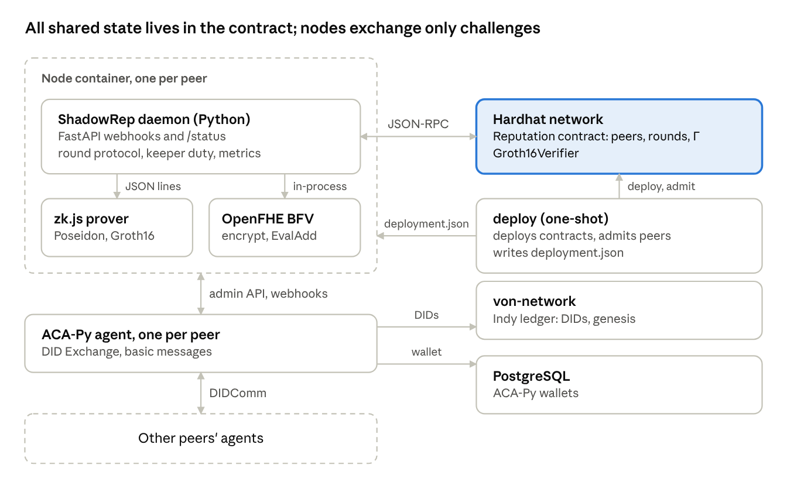
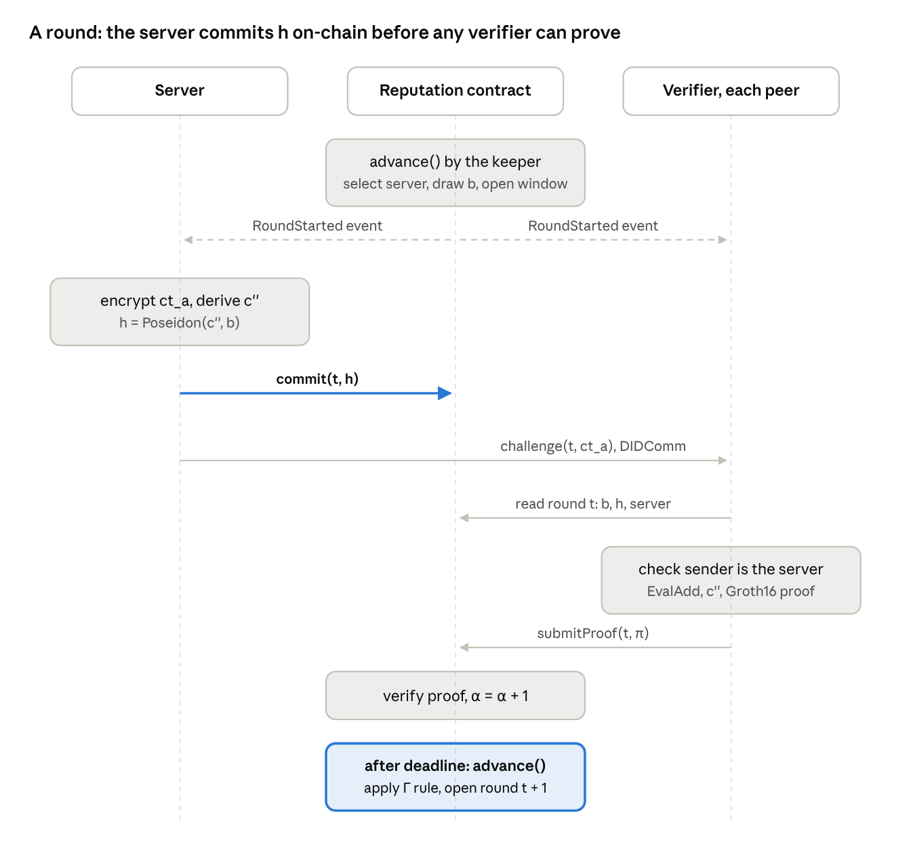

# BBYOR (ShadowRep) — Software Design Document

Oct 27, 2026 · exported from the [living doc](https://claude.ai/artifact/Say45EqjQkA7pK9bvYZ52j); the doc may be newer than this copy.

## Overview

BBYOR (published as ShadowRep) measures, verifiably and on-chain, whether a peer serves the network: each round one random peer issues an FHE challenge, the others prove in zero knowledge that they answered it, and the contract updates the server's reputation from the quorum. This document describes version 2 of the system, on the `dev` branch of [mateus-n00b/bbyor](https://github.com/mateus-n00b/bbyor); the normative protocol spec is [`docs/PROTOCOL.md`](PROTOCOL.md).

It is written for engineers who maintain the code or run experiments with it. It covers the smart contract, the zero-knowledge circuit and its helper, the Python node, and the tooling that generates and runs scenarios.

| Term | Meaning |
| --- | --- |
| Round | One selection window of 30–40 s, numbered from 1 by the contract |
| Server (proposer) | The peer selected for the round; it commits to and distributes the challenge |
| Verifier (challenged node) | Every other admitted peer; it computes the response and submits a proof |
| Keeper | Any account that calls `advance()` to close a round and open the next; node0 by default |
| Γ (reputation) | The server's score, 0–1000 on-chain (0–1 in the paper), initially 350 |
| α (responses) | Valid proofs accepted in a round, at most one per verifier |
| β (eligible) | Admitted peers minus one, fixed when the round opens |
| b (nonce) | Per-round random field element drawn by the contract |
| h (commitment) | Poseidon(result, b), published by the server before it sends the challenge |

## Goals, non-goals and constraints

The design optimizes for verifiable, replay-proof attestations and reproducible experiments, not for production deployment.

**Goals**

- A server's reputation changes only from facts the contract can check: its own commitment and verifiers' valid proofs.
- A proof is valid for exactly one round and one account, so it cannot be replayed or transferred.
- One identity per peer: each account maps to one DID and back, and every peer action uses `msg.sender`.
- Pluggable challenge schemes (`fhe`, `plain`) and attestations (`zk`, `signature`), so the FHE+ZKP cost can be compared against a baseline on the same flow.
- Scenarios (node count, behaviours, round length) are declared in one TOML file and run without manual copying of addresses or DIDs.

**Non-goals**

- Hiding reputation scores: Γ is stored in plaintext in the contract.
- Open, permissionless admission: peers are admitted by the contract owner.
- Production-grade randomness or a multi-party trusted setup.

**Constraints**

- OpenFHE has no portable wheel; it is built from source inside the node image (Python 3.12, Debian bookworm).
- The circuit's proving key and the deployed verifier come from the same `circuits/build.sh` run, so both images must be rebuilt after a new setup.
- Experiments run all containers on one host, with Docker 29 or Podman ≥ 4.1.

## Architecture overview

Each peer runs two containers, a ShadowRep daemon and its own ACA-Py agent; the contract on the Hardhat network is the only shared state, and peers exchange nothing but challenges over DIDComm.



The daemon calls the contract over JSON-RPC, its agent over the admin API, and receives the agent's webhooks. Proofs come from a `zk.js` subprocess; OpenFHE runs inside the daemon process.

## Protocol and round lifecycle

A round lasts 30–40 s and its outcome is decided entirely on-chain: the server's commitment h and the count α of valid proofs feed the reputation rule when the keeper closes the round.



The server derives c'' as the first 31 bytes of SHA-256 over the serialized `EvalAdd(ct_a, b mod 65537)` followed by b, and commits h before sending anything. A verifier that is not yet connected to the server opens a DID exchange and sends `request_challenge`; the server then replays the stored challenge. With the `signature` attestation, steps after the challenge are replaced by a signed result sent back to the server, and nothing is written on-chain.

The update rule applied at finalization, on a 0–1000 scale:

```math
\Gamma_{t+1} = \begin{cases} 0.5\,\Gamma_t & \alpha = 0 \\ 0.8\,\Gamma_t & 0 < \alpha < \tfrac{2}{3}\beta \\ \min\!\left(1000,\ \Gamma_t + 20\,\alpha/\beta\right) & \alpha \ge \tfrac{2}{3}\beta \end{cases}
```

## Component design

Three components carry the protocol: a Solidity contract that owns all state, a Circom circuit with a Node.js helper that produces proofs, and a Python node that drives each peer.

### Reputation contract

`contracts/src/Reputation.sol` is the single source of truth for peers, rounds and scores. It holds the Groth16 verifier as an immutable external contract (`IGroth16Verifier`), generated by snarkjs into `contracts/src/generated/` and never edited by hand.

- **Peers.** `registerPeer(account, did)` is owner-only and rejects a reused account or DID. Each peer stores its DID, reputation and a registered flag; `accountOfDid` gives the reverse lookup.
- **Rounds.** A `Round` stores server, deadline, β, α, finalized flag, nonce and commitment. `advance()` finalizes the current round if its deadline passed and starts the next; it never selects the previous server twice in a row.
- **Commit and prove.** `commit()` accepts one non-zero field element from the server before the deadline. `submitProof()` rebuilds the public signals `[nonce, commitment, uint160(msg.sender)]` from storage and reverts on an invalid proof, a repeated verifier, the server itself or a closed round.
- **Reputation rule.** `ReputationMath.update()` is a pure library function: ×0.5 with no responses, ×0.8 below a 2/3 quorum, otherwise +20·α/β capped at 1000.
- **Randomness.** `_random()` hashes `prevrandao`, the previous block hash, the round and a salt. It is `virtual` so a commit-reveal or VRF version can replace it.

### Circuit and ZK helper

`circuits/src/response.circom` proves knowledge of a private `result` with `Poseidon(result, nonce) == commitment`. Its public inputs are `nonce`, `commitment` and `verifier`; a `verifier²` constraint keeps the verifier signal in the constraint system so the proof is bound to the submitting account.

`circuits/build.sh` compiles the circuit, runs the phase-2 setup on the public PSE Perpetual Powers of Tau (`ppot_0080_12`), and exports the verification key and the Solidity verifier. All outputs are git-ignored.

`zk/zk.js` wraps circomlibjs and snarkjs. It exposes `commit()` and `prove()` for the Hardhat tests and, with `serve`, runs as a long-lived JSON-lines server for the node. Poseidon tables are built once at start-up, and proofs are returned already laid out as `verifyProof` arguments.

### Python node

The node package (`node/bbyor/`) is split by concern, so the protocol class can be tested with fakes.

| Module | Responsibility |
| --- | --- |
| `config.py` | `Settings` from environment variables, plus the `Scheme`, `Attestation` and `Behaviour` enums |
| `chain.py` | Async web3 client: reads rounds and peers, polls events, signs transactions with a 20% gas margin |
| `agent.py` | Async ACA-Py admin client: readiness, DID exchange, outbound and inbound connections, basic messages |
| `zk.py` | Client for the `zk.js serve` subprocess, matching replies to requests by id |
| `crypto/schemes.py` | `PlainScheme` and `FheScheme` (OpenFHE BFV, keys persisted in `key_dir`) |
| `crypto/field.py` | `to_field()`: the first 31 bytes of SHA-256, always below the BN254 field |
| `messages.py` | Typed DIDComm payloads: `Challenge`, `RequestChallenge`, `SignedResult` |
| `behaviour.py` | Server behaviours for simulation: `Honest`, `Intermittent`, `OnOff` |
| `node.py` | `Node`: the round protocol, event loop, keeper duty and metrics |
| `app.py` | FastAPI app: ACA-Py webhooks, `/status`, start-up and shutdown |
| `metrics.py` | Appends one JSON line per timed operation |

OpenFHE calls run on the event-loop thread on purpose. The library deadlocks the process when first used from a worker thread, and each call takes about 10–30 ms.

## Interfaces and data

Nodes talk to each other only through DIDComm basic messages and to the contract only through the calls and events below; there is no other shared state.

### Contract API

| Function | Caller | Effect |
| --- | --- | --- |
| `registerPeer(account, did)` | Owner | Admits a peer at reputation 350 |
| `advance()` | Anyone | Finalizes the expired round, starts the next |
| `canAdvance()` (view) | Anyone | True when `advance()` would succeed |
| `finalize(round)` | Anyone | Finalizes an expired round without starting another |
| `commit(round, commitment)` | Round server | Stores h once, before the deadline |
| `submitProof(round, pA, pB, pC)` | Admitted verifier | Verifies the proof on-chain, increments α |
| `rounds(id)`, `peers(account)`, `peerList(i)`, `peerCount()`, `reputationOf(account)`, `reputationOfDid(did)` (views) | Anyone | Read state |

Failures revert with custom errors (`NotOwner`, `RoundActive`, `RoundClosed`, `NotServer`, `ServerCannotVerify`, `NotCommitted`, `AlreadyResponded`, `InvalidCommitment`, `InvalidProof` and others), so the node's gas estimation fails before a transaction is sent.

### Events

| Event | Fields |
| --- | --- |
| `PeerRegistered` | account, did |
| `RoundStarted` | round, server, did, nonce, deadline |
| `ChallengeCommitted` | round, commitment |
| `ProofAccepted` | round, verifier |
| `RoundFinalized` | round, server, responses, eligible, rep |

Nodes poll logs once per `POLL_INTERVAL` and order them by block and log index. `RoundFinalized` is also what the reputation collector writes to CSV.

### DIDComm messages

Payloads are JSON in the `content` of an ACA-Py basic message, validated by a Pydantic discriminated union on `type`.

| Type | Fields | Sent by |
| --- | --- | --- |
| `challenge` | round, scheme, payload (hex ciphertext or plain value) | Server, over its inbound connections |
| `request_challenge` | round | A verifier that has just connected to the server |
| `signed_result` | round, result, signature | A verifier, in signature-attestation mode only |

### Configuration

The node reads its settings from environment variables; the scenario generator sets them per container.

| Variable | Default | Purpose |
| --- | --- | --- |
| `PUBLIC_DID`, `PRIVATE_KEY` | required | Identity and Ethereum account |
| `ACAPY_URL` | `http://localhost:8250` | Agent admin API |
| `PROVIDER_URL`, `DEPLOYMENT_FILE` | `http://localhost:8545`, `sim/out/deployment.json` | Chain endpoint and contract address + ABI |
| `SCHEME`, `ATTESTATION` | `fhe`, `zk` | Challenge scheme and attestation mode |
| `BEHAVIOUR` | `honest` | `honest`, `intermittent` or `on_off` |
| `FAIL_PROBABILITY`, `ATTACK_THRESHOLD`, `SEED` | 0.3, 600, 12 | Behaviour parameters |
| `KEEPER` | false | Call `advance()` whenever possible |
| `POLL_INTERVAL` | 1.0 s | Event polling period |
| `METRICS_FILE`, `KEY_DIR`, `LOG_LEVEL` | `metrics.jsonl`, `~/.config/bbyor`, INFO | Outputs and FHE keys |

## Deployment and operations

An experiment is one scenario file turned into one compose project: the generator registers DIDs, assigns accounts and writes everything the stack needs, so no address or DID is copied by hand.

### Images

| Image | Built from | Contents |
| --- | --- | --- |
| `bbyor-node:dev` | `docker/Dockerfile.node` | Multi-stage: OpenFHE v1.2.4 and openfhe-python v0.8.10 compiled from source; runtime with the node package, Node.js, `zk.js` and the proving key |
| `bbyor-chain:dev` | `docker/Dockerfile.chain` | Hardhat with the compiled contracts and `scripts/deploy.js` |

Both images embed artifacts from the same `npm run build:circuits` run. A new setup without rebuilding both makes every proof fail on-chain.

### Scenario generator

`sim/generate.py <scenario.toml>` expands node groups, derives Indy seeds from the scenario seed, registers each DID on von-network, and gives node *i* Hardhat account *i*+1 (account 0 deploys). It writes three files to `sim/out/`:

- `peers.json`: account and DID per node, read by the deploy script and by the heatmap plot.
- `docker-compose.yml`: postgres, chain, a one-shot deploy, and one agent and one node per peer.
- `.env`: the compose project name, `bbyor`, for both docker-compose v1 and v2.

Scenario keys: `seed`, `scheme`, `attestation`, `min_interval`, `max_interval`, `von_network`, `runtime`, `genesis_url`, `api_port_base`, and `[[nodes]]` groups with `count`, `behaviour`, `fail_probability` and `attack_threshold`. The `rounds` key some scenarios carry is not implemented yet, so experiments do not stop on their own.

### Start-up order

1. `chain` starts Hardhat with 64 funded accounts and a block every second.
2. `deploy` deploys the verifier and the contract, admits the peers, and writes `deployment.json`.
3. Each node waits until that file exists **and** the contract has code at its address, then until its agent reports ready.
4. Each node connects to every registered peer, starts the zk server and its event loop; node0 is the keeper.

Step 3 covers compose implementations that ignore `depends_on` conditions, and stale deployment files from earlier runs.

### Docker and Podman

The `runtime` key changes how agents reach von-network on the host. With `docker`, agents use `host.docker.internal` through `host-gateway`. With `podman`, they use `host.containers.internal`, which Podman ≥ 4.1 provides; `host-gateway` exists only from Podman 5.3. A scenario generated for one runtime fails on the other: agents cannot fetch the genesis file and restart in a loop. With docker-compose 1.29 on Docker 29, run `down` before `up` after rebuilding images.

### Collecting results

| Script | Output |
| --- | --- |
| `experiments/collect_reputation.py` | CSV of `RoundFinalized` events with block time |
| `experiments/collect_metrics.sh` | Merged `metrics.jsonl` from every node container (Docker or Podman) |
| `experiments/plot_reputation.py` | Heatmap of reputation per node, by rounds (default) or time |
| `experiments/plot_metrics.py` | Latency bars with 95% confidence intervals, optionally against a baseline file |

## Security design and threat model

v2 closes replay, forged votes and duplicate votes on-chain; collusion between verifiers, plaintext scores and biasable randomness remain open by design.

| Threat | Mitigation in v2 | Residual risk |
| --- | --- | --- |
| Proof replay across rounds or accounts | Public signals built on-chain from the round's nonce and commitment and `msg.sender` | Low |
| Duplicate or forged votes | One proof per verifier per round; the voter is `msg.sender`, never a DID parameter | Low |
| Server that only pretends | No proof is possible without a commitment; a round with no valid proof applies ×0.5 | Low |
| Server impersonation | Verifiers accept a challenge only on the connection they opened to the server's public DID | Low |
| Inflated quorum denominator | β comes from the owner-admitted peer list, fixed at round start | Low |
| Sybil identities, whitewashing | Owner-only admission; account and DID both unique | Low while admission stays permissioned |
| Collusion: relaying `result` | None: a verifier that got the payload can pass `result` to another admitted peer | Moderate |
| Unattributable failed round | `h` is on-chain, but there is no dispute phase | Moderate |
| Randomness bias | `prevrandao` and the previous block hash | Moderate; a block producer can bias selection |
| Score inference | None: Γ is public contract state | High |
| Forged proof | Groth16 on BN254; phase 1 from a public multi-party ceremony | Phase 2 has a single contributor (development only) |

Server authentication depends on one ACA-Py detail. Only the requester side of a DID exchange records an authenticated `their_public_did`, so servers send challenges over inbound connections. A `challenge` that arrives on any other connection is ignored.

## Testing and verification

Every layer has automated tests, and the full stack (von-network, 4 ACA-Py agents, OpenFHE, real proofs) was run end to end before the 20-node experiments.

| Suite | Command | What it covers |
| --- | --- | --- |
| Contract, mock verifier (19 tests) | `npm test` | Admission, round timing, commit rules, vote rules, every branch of the reputation rule, the 1000 cap |
| Contract, real verifier (3 tests) | `npm test` (needs `build:circuits`) | Proof bound to sender, forged preimage rejected, replay from a previous round rejected |
| Node unit tests (16) | `uv run pytest -m "not integration"` | Schemes, behaviours, message parsing, server and verifier flows with fake chain, agent and prover |
| Node integration (3) | `uv run pytest -m integration` | Full rounds on Hardhat with the real contract, verifier and proofs over an in-memory DIDComm network; penalty for a withholding server; waiting for a live deployment |
| FHE scheme (2) | inside `bbyor-node:dev` (see `node/tests/test_fhe.py`) | A verifier with other keys derives the server's result; keys persist with mode 600 |

The integration tests replace only ACA-Py (by an in-memory network) and OpenFHE (by the `plain` scheme). Their Hardhat fixture runs in its own process group, so no node process outlives the test.

Running the full stack found four defects that no test had caught, all fixed in v2:

- A fresh OpenFHE ciphertext serializes differently from a deserialized one, so verifiers never matched the server's result. The server now derives its result from the serialized payload.
- Challenges sent over the server's own connections arrived where the verifier had no authenticated DID, and were all rejected.
- OpenFHE deadlocked the process when first called from a worker thread.
- `advance()` ran out of gas because the estimate ran in a different block context; a 20% margin fixed it.

## Performance

A verifier answers a challenge in 361 ms on average, 65% of it Groth16 proving, which is far inside the 30 s minimum round. Figures below come from two 20-node sessions on one host (Intel i7-1355U, 32 GB): FHE+ZK over 460 rounds (8,400 responses) and the plain+signature baseline over 416 rounds (7,578 responses).

| Operation | Role | FHE + ZK, mean (ms) | Baseline, mean (ms) |
| --- | --- | --- | --- |
| Challenge creation | Server | 28.6 | 0.04 |
| Poseidon commitment | Server | 2.4 | — |
| Commit transaction | Server | 36.6 | — |
| Response computation | Verifier | 19.4 | 0.03 |
| Proof / signature | Verifier | 236.5 | 7.8 |
| Proof submission, verified on-chain | Verifier | 104.2 | — |
| Signature check, per response | Server | — | 9.7 |
| Total per response | Verifier | 361.0 | 18.6 |

On a like-for-like scope (computing the result and producing its attestation) FHE+ZK costs 256 ms against 7.9 ms, about 33×. The two totals differ in scope: the FHE+ZK total includes the on-chain submission, and the baseline total includes the DIDComm reply.

On-chain cost, measured separately with the real verifier on Hardhat: about 101k gas for `advance()`, 50k for `commit()` and 273k per `submitProof()`, so about 5.3 Mgas per round with 19 verifiers. Each FHE challenge carries a BFV ciphertext of about 385 KiB, sent to every connection, about 7 MiB per round at 20 nodes.

Proof time fell from about 5.2 s in v1 to 236 ms. v1 launched one snarkjs process per step for every proof and made the server produce a proof only to compute h; v2 keeps one prover process per node and computes Poseidon natively.

## Design decisions, limitations and future work

The main trade-off of v2 is a permissioned, plaintext-score contract in exchange for attestations that cannot be replayed or forged.

### Key decisions

| Decision | Alternative rejected | Reason |
| --- | --- | --- |
| Server commits h on-chain before sending the challenge | h sent only over DIDComm (v1) | The contract can bind proofs to h and penalize a server that never commits |
| Public signals rebuilt by the contract | Verifier-supplied signals (v1) | Prevents replay across rounds and accounts |
| β = admitted peers − 1 | Neighbors registered on the fly (v1) | Anyone could inflate the denominator; it grew with respondents |
| Keeper-driven `advance()` | Every node calls `updateServerRep` each poll (v1) | One transaction per transition instead of failing calls from every node |
| Persistent zk server per node | snarkjs CLI per step | Removes process start-up from every proof |
| Event-log polling | Polling `getLastChosenPeer` | Ordered, complete view of round transitions |
| Server derives its result from the serialized payload | From the in-memory ciphertext | In-memory and deserialized ciphertexts serialize differently |

### Known limitations

- Γ is plaintext contract state; nothing proves predicates over it yet.
- No dispute phase: a round with no proofs cannot be attributed to the server or to withholding verifiers.
- A verifier can relay `result` to another admitted peer.
- On-chain verification costs about 273k gas per verifier and grows linearly with network size.
- Randomness is biasable; the phase-2 setup has one contributor.
- Each pair of peers holds two DIDComm connections, one opened by each side.
- The scenario key `rounds` is accepted but ignored, so runs are stopped by hand.
- Every experiment so far ran on a single host with a single-node development chain.

### Future work

- [ ] Stop an experiment after N finalized rounds (`rounds` key, `experiments/run.sh`)
- [ ] Commit a digest of the ciphertext and add a dispute phase
- [ ] Replace plaintext Γ with commitments and threshold proofs
- [ ] Aggregate or sample verifier proofs to bound gas per round
- [ ] Commit-reveal or VRF randomness behind `_random()`
- [ ] Multi-party phase-2 ceremony
- [ ] Evaluation on a network with real consensus (e.g., Besu with QBFT) and on physical devices
